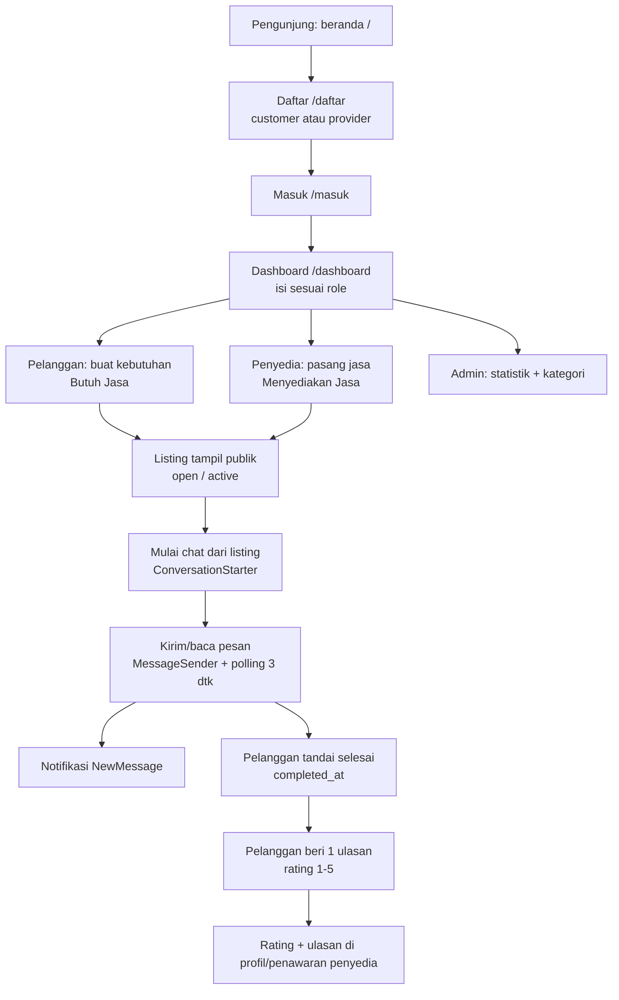
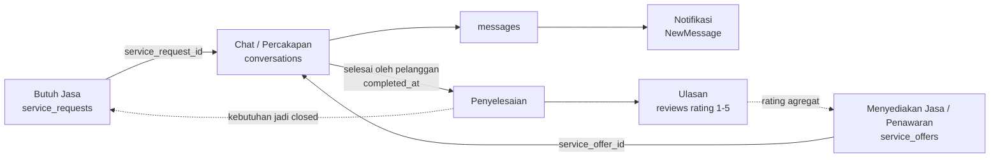
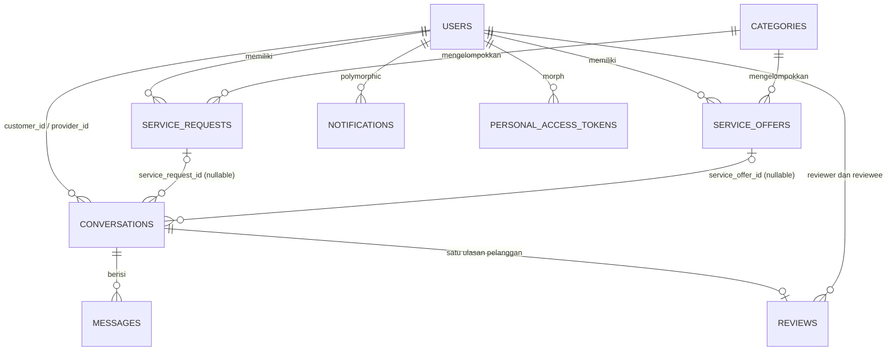
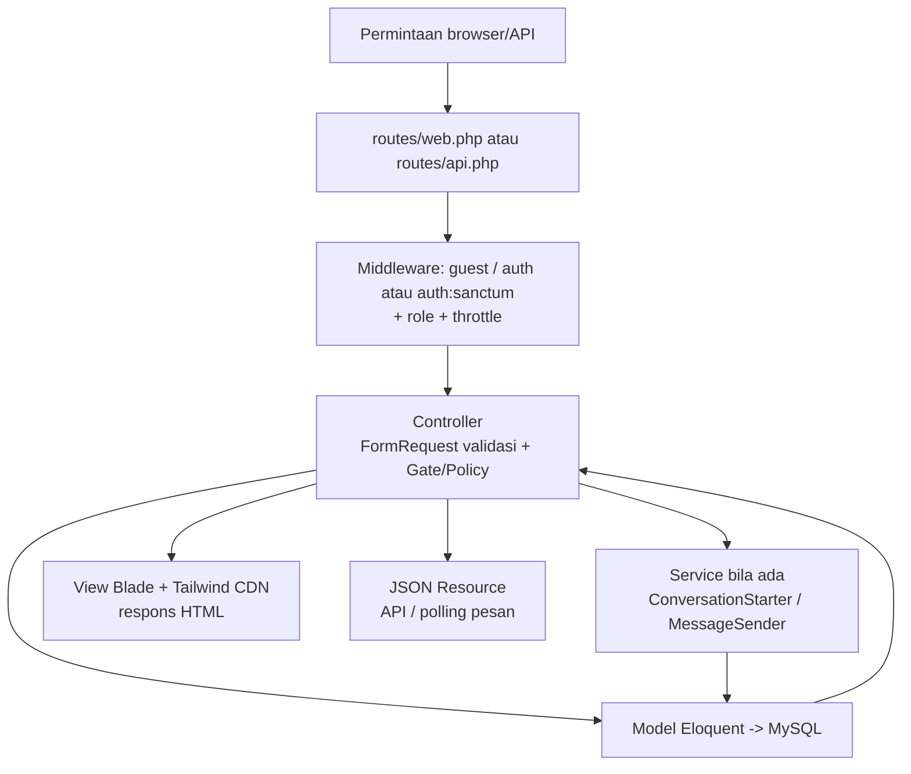
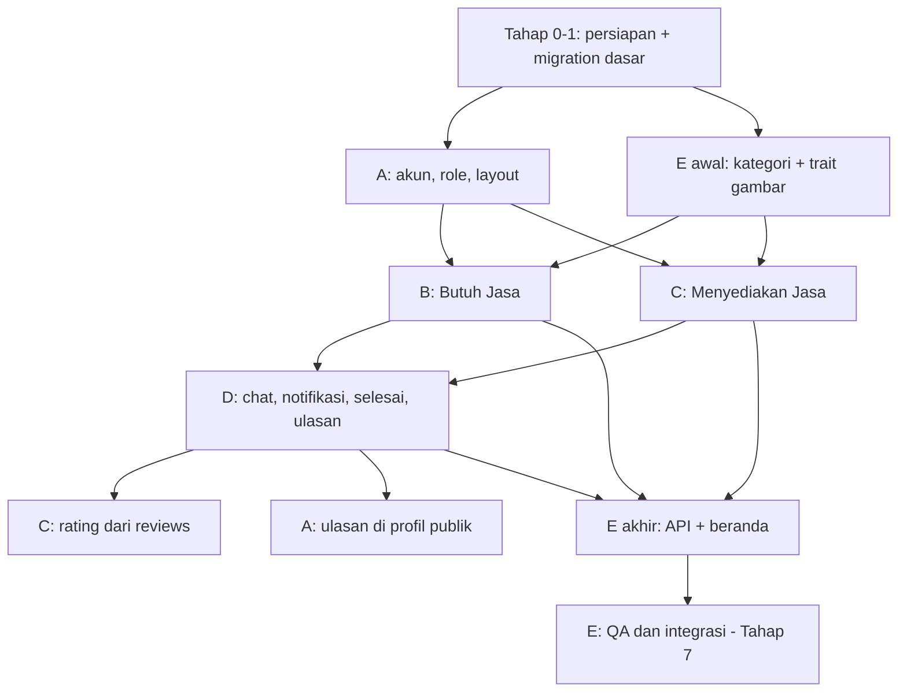

# PROJECT_PRD.md — Panduan Utama Project Bantuin

> **Fungsi dokumen ini:** menjelaskan **apa itu Bantuin dan bagaimana aplikasinya bekerja** (tujuan, role, halaman, alur, fitur, database, aturan akses, integrasi, pengujian) agar semua anggota memahami aplikasi **sebelum coding**.
>
> **Pasangannya:** [`TEAM_TASK_ASSIGNMENT.md`](TEAM_TASK_ASSIGNMENT.md) menjelaskan **siapa mengerjakan file apa** (Anggota A–E, folder, file, batas, urutan kerja). Dokumen ini **tidak mengulang daftar file per anggota**; ia merujuk ke sana.
>
> **Sumber acuan:** PDF *Pedoman Kerja Tim – Project Bantuin* (versi terbaru) yang diturunkan dari `DOKUMENTASI_PROJECT_BANTUIN.md`. Fitur, alur bisnis, dan tahapan **tidak diubah**. Hal yang belum dijelaskan sumber ditandai **[SEPAKATI]** (daftar di Bagian 13); jangan dikarang.

**Tanda penamaan:** nama tanpa tanda = disebut di dokumentasi asli; **†** = nama saran (turunan konvensi Laravel/nama route) yang harus dicocokkan dengan repository.

---

## Daftar Isi
1. Deskripsi dan Tujuan Project
2. Teknologi dan Ketentuan Wajib
3. Role Pengguna
4. Daftar Halaman dan Fitur per Role
5. Alur Kerja Aplikasi (Registrasi → Penyelesaian)
6. Penjelasan Fitur dan Hubungan Antarfitur
7. Hubungan Butuh Jasa, Menyediakan Jasa, Penawaran, Pesanan, Chat, Notifikasi, Penyelesaian, Ulasan
8. Database: Relasi, Tabel, Model, Migration
9. Alur Komunikasi Route → Controller → Model → Blade dan Integrasi Backend–Frontend
10. Aturan Akses dan Hak Role
11. Ketergantungan Antarfitur dan Urutan Implementasi
12. Ketentuan Integrasi dan Pengujian
13. Hal yang Perlu Disepakati Tim
14. Status dan Batas Cakupan Saat Ini

---

## 1. Deskripsi dan Tujuan Project

**Bantuin** adalah aplikasi **marketplace jasa sederhana** yang mempertemukan **pelanggan** (`customer`) dan **penyedia jasa** (`provider`) melalui dua jenis listing:

| Listing | Dibuat oleh | Cara kerja |
|---|---|---|
| **Butuh Jasa** (kebutuhan) | Pelanggan | Pelanggan mempublikasikan kebutuhan; penyedia dapat memulai percakapan dari kebutuhan itu. |
| **Menyediakan Jasa** (penawaran) | Penyedia jasa | Penyedia mempublikasikan jasa; pelanggan dapat memulai percakapan dari penawaran itu. |

Setelah bertemu lewat listing, kedua pihak berkomunikasi lewat **chat**; pelanggan menandai pekerjaan **selesai** dan memberi **ulasan** yang membentuk rating penyedia.

**Tujuan project:**
- Menyediakan alur lengkap *daftar → pasang listing → chat → selesai → ulasan*.
- Menjadi tugas tim (5 anggota) yang dikerjakan **per fitur dari backend hingga Blade**.
- Memenuhi syarat teknologi: **Laravel 13 murni berbasis PHP** dengan **Blade** untuk tampilan.

---

## 2. Teknologi dan Ketentuan Wajib

| Komponen | Ketentuan |
|---|---|
| Framework backend | **Laravel 13** (`laravel/framework ^13.0`), **PHP `^8.3`** |
| Tampilan | **Blade** (server-side) + **Tailwind CSS via Play CDN resmi** (satu tag `<script>` di `resources/views/layouts/app.blade.php`) |
| Database | **MySQL** (ketentuan tim) |
| Autentikasi web | Session Laravel (`auth`, `guest`) |
| Autentikasi API | **Laravel Sanctum 4** (token personal) |
| Alat lain | Composer, Laravel Tinker 3, PHPUnit 12 (dev) |

**Dilarang:** Node.js, npm, Vite, serta framework backend JavaScript (Express, Nest, Next server, dll.). Konsekuensinya:
- Tidak ada `npm install`, `npm run dev`, `npm run build`; tidak ada berkas yang perlu dikompilasi.
- Jika layout/view masih memanggil `@vite(...)`, **hapus** (hasil build tidak ada).
- JavaScript browser (menu mobile, status tombol form, **polling chat**) dimuat sebagai `<script>` biasa di Blade atau berkas di `public/` (tidak lewat build).
- Axios, Laravel Echo, dan Pusher JS (paket npm) **tidak tersedia**; polling chat memakai `fetch`, sehingga chat tetap berjalan. Realtime Reverb tetap berstatus **parsial**.
- Tailwind **Play CDN** dirancang untuk pengembangan dan butuh internet saat halaman dibuka; jika kelak dideploy ke produksi, tim menilai ulang **[SEPAKATI]**.

**Pemasangan Tailwind (sekali, pemilik: Anggota A)** di `<head>` `layouts/app.blade.php`:

```html
<script src="https://cdn.jsdelivr.net/npm/@tailwindcss/browser@4"></script>
```

> Alamat CDN di atas ditulis dari pengetahuan umum; **verifikasi ke dokumentasi resmi Tailwind** sebelum dipasang.

Struktur folder yang berperan (detail pemilik di `TEAM_TASK_ASSIGNMENT.md` Bagian 11):

| Lokasi | Tanggung jawab |
|---|---|
| `app/Http/Controllers/` (+ `Admin/`, `Api/`) | Controller web dan API |
| `app/Http/Requests/`, `app/Http/Resources/` | Validasi form; bentuk JSON API |
| `app/Http/Middleware/` | `RoleMiddleware` |
| `app/Models/`, `app/Policies/`, `app/Services/` | Model Eloquent; aturan kepemilikan; logika chat bersama web/API |
| `app/Events/`, `app/Notifications/` | Event pesan; notifikasi database |
| `database/migrations/`, `factories/`, `seeders/` | Skema; data uji; data demo |
| `resources/views/` | Template Blade |
| `routes/web.php`, `routes/api.php`, `routes/channels.php` | Route web (session + CSRF); API JSON (prefix `/api`); otorisasi channel |
| `bootstrap/app.php` | Registrasi file route dan alias middleware `role` |
| `tests/Feature/` | Feature test |

---

## 3. Role Pengguna

Role disimpan sebagai string pada `users.role`.

| Role | Cara mendapat akun | Fokus peran |
|---|---|---|
| **Pelanggan** (`customer`) | Mendaftar publik di `/daftar` | Membuat/mengelola kebutuhan; memulai chat dari penawaran aktif; menandai selesai; memberi ulasan. |
| **Penyedia Jasa** (`provider`) | Mendaftar publik di `/daftar` | Membuat/mengelola penawaran; memulai chat dari kebutuhan terbuka; membalas pesan. |
| **Admin** (`admin`) | **Tidak bisa mendaftar publik**; berasal dari data yang dibuat/diubah administratif, termasuk seeder demo | Melihat statistik dashboard; mengelola kategori; dapat menghapus listing lewat route bersama. |

Akun demo (admin/pelanggan/penyedia) dibuat oleh `DatabaseSeeder` dan **tidak boleh dipakai di produksi**.

---

## 4. Daftar Halaman dan Fitur per Role

### 4.1 Pengunjung (belum login)
| Halaman / route | Fungsi |
|---|---|
| `/` | Beranda: hingga 3 kebutuhan `open` dan 3 penawaran `active` terbaru. |
| `/daftar`, `/masuk` | Daftar (nama, email, password, role, nomor HP opsional) dan login. |
| `/butuh-jasa`, `/butuh-jasa/{id}` | Daftar kebutuhan `open` (cari kata kunci, filter kategori, pagination) dan detailnya. |
| `/menyediakan-jasa`, `/menyediakan-jasa/{id}` | Daftar penawaran `active` dan detailnya (harga, kategori, penyedia, rating). |
| `/pengguna/{id}` | Profil publik (tanpa login). |

### 4.2 Pelanggan
| Halaman / route | Fungsi |
|---|---|
| `/dashboard` | Kebutuhan milik sendiri + status; tombol buat, ubah, hapus. |
| `/butuh-jasa/buat`, `/butuh-jasa/{id}/ubah` | Form kebutuhan: kategori, judul, deskripsi, anggaran, lokasi, deadline (opsional), gambar; status saat ubah. |
| `/menyediakan-jasa`, `/{id}` | Menjelajah jasa aktif; mulai chat dari penawaran aktif. |
| `/chat`, `/chat/{id}` | Inbox dan percakapan; **tandai selesai**; **beri ulasan**. |
| `/notifikasi` | Notifikasi pesan baru; tandai dibaca satu/semua. |
| `/profil`, `/pengguna/{id}` | Ubah profil, avatar, kota, bio, password; profil publik. |

Pelanggan **tidak** punya route web untuk membuat/mengelola penawaran.

### 4.3 Penyedia Jasa
| Halaman / route | Fungsi |
|---|---|
| `/dashboard` | Penawaran milik sendiri + status + rating agregat; tombol pasang, ubah, hapus. |
| `/menyediakan-jasa/buat`, `/{id}/ubah` | Form penawaran: kategori, judul, deskripsi, harga, lokasi, gambar; status `active`/`inactive` saat ubah. |
| `/butuh-jasa`, `/{id}` | Menjelajah kebutuhan terbuka; mulai chat dari kebutuhan yang masih `open`. |
| `/chat`, `/chat/{id}` | Inbox, baca dan kirim pesan. Penyedia **tidak** dapat menandai selesai atau memberi ulasan. |
| `/notifikasi`, `/profil`, `/pengguna/{id}` | Notifikasi; profil/password; profil publik (penawaran aktif + ulasan diterima). |

Penyedia **tidak** dapat membuat kebutuhan pelanggan.

### 4.4 Admin
| Halaman / route | Fungsi |
|---|---|
| `/dashboard` | Statistik: jumlah pengguna, kebutuhan, penawaran, kategori (bukan daftar pengelolaan). |
| `/admin/kategori` | Daftar kategori + jumlah kebutuhan/penawaran terkait; tambah; hapus. |
| `DELETE /butuh-jasa/{id}`, `DELETE /menyediakan-jasa/{id}` | Menghapus listing lewat route bersama (tetap diperiksa policy). |
| Route umum | Halaman publik, profil, notifikasi tetap terdaftar; admin **tidak** dapat memulai chat. |

### 4.5 Halaman dan komponen bersama
- Layout `resources/views/layouts/app.blade.php`: navigasi (Butuh Jasa, Menyediakan Jasa, Chat, Notifikasi, Dashboard, Profil, Keluar); link **Kategori** hanya untuk admin.
- Halaman autentikasi di `resources/views/auth/`; halaman error kustom 403, 404, 419, 429, 500.
- Partial: kartu listing, filter, field form, avatar, rating.

---

## 5. Alur Kerja Aplikasi (Registrasi → Penyelesaian)

### 5.1 Gambaran besar



### 5.2 Jalur A — dari kebutuhan pelanggan
1. Pelanggan mengisi form kebutuhan → divalidasi `ServiceRequestRequest`.
2. Data disimpan ke `service_requests` (pemilik, kategori, gambar opsional di disk `public`).
3. Tampil di **Butuh Jasa** dan beranda (hanya status `open`).
4. Penyedia menekan **mulai chat** → `ConversationStarter` (cek role penyedia, `firstOrCreate`: pasangan peserta + listing yang sama tidak menggandakan percakapan).
5. `MessageSender`: simpan pesan, sentuh waktu aktivitas percakapan, buat notifikasi database bila belum ada yang belum dibaca, coba event `MessageSent`.
6. Pelanggan menandai **selesai**: `completed_at` terisi; bila percakapan terkait kebutuhan, status kebutuhan menjadi `closed`.
7. Pelanggan membuat **satu ulasan** untuk penyedia; rating dan komentar muncul di profil publik dan rating agregat penawaran.

### 5.3 Jalur B — dari penawaran penyedia
1. Penyedia mengisi form penawaran → `ServiceOfferRequest`.
2. Disimpan ke `service_offers` (pemilik, kategori, gambar).
3. Tampil di **Menyediakan Jasa** (hanya `active`) beserta rating dari `reviews`.
4. Pelanggan memulai chat dari penawaran aktif (`service_offer_id`).
5. Chat, notifikasi, pesan: service yang sama dengan Jalur A. Aksi selesai **hanya mengisi `conversations.completed_at`**; **tidak ada status penawaran yang otomatis diubah**.
6. Pelanggan memberi ulasan setelah selesai.

### 5.4 Alur pesan dan realtime
| Langkah | Detail |
|---|---|
| Mulai chat | `POST /chat` (`ConversationStarter`) |
| Kirim pesan | `POST /chat/{conversation}/pesan` (throttle `30,1`, CSRF) |
| Ambil pesan baru | Browser memanggil `fetch` tiap **3 detik**: `GET /chat/{conversation}/pesan?after={id}` (JSON) |
| Notifikasi | `NewMessage` (database), dibuat bila belum ada notifikasi belum dibaca untuk percakapan itu |
| Selesai | `POST /chat/{conversation}/selesai` |
| Ulasan | `POST /chat/{conversation}/ulasan` |

Event `MessageSent` membawa **ID saja**; channel privat `conversation.{id}` hanya untuk peserta; isi pesan tetap diambil lewat endpoint yang memeriksa akses. **Polling adalah jalur default**; realtime Reverb butuh paket/konfigurasi tambahan (belum ada di `composer.json`) dan tanpa npm tidak ada klien Echo.

---

## 6. Penjelasan Fitur dan Hubungan Antarfitur

| Fitur | Penjelasan singkat | Bergantung pada | Dipakai oleh | Pemilik (lihat TEAM) |
|---|---|---|---|---|
| Akun & role | Register/login/logout, `users.role`, `RoleMiddleware` | — | Semua fitur | A |
| Kerangka tampilan | Layout, navigasi, komponen form/avatar, halaman error | — | Semua halaman | A |
| Profil & dashboard | Profil/avatar/password, profil publik, dashboard per role | Akun; listing (B,C); ulasan (D) | — | A |
| Kategori | Master kategori listing; admin tambah/hapus | Akun admin | Butuh Jasa, Menyediakan Jasa | E |
| Unggah gambar | Trait penyimpan gambar listing di disk `public` | — | Butuh Jasa, Menyediakan Jasa | E |
| **Butuh Jasa** | CRUD kebutuhan, filter, status | Akun, kategori, gambar | Chat, API, beranda, dashboard | B |
| **Menyediakan Jasa** | CRUD penawaran, filter, rating | Akun, kategori, gambar; rating ← Ulasan | Chat, API, beranda, dashboard, profil | C |
| **Chat** | Percakapan dan pesan antara pelanggan–penyedia | Akun; listing sumber | Notifikasi, Selesai, Ulasan, API | D |
| **Notifikasi** | Notifikasi database pesan baru | Chat | Navigasi/halaman notifikasi | D |
| **Penyelesaian** | Pelanggan menandai pekerjaan selesai | Chat | Ulasan; status kebutuhan `closed` | D |
| **Ulasan** | Satu ulasan pelanggan, rating 1–5 | Penyelesaian | Rating penawaran, profil publik | D |
| REST API | Login token, listing, percakapan, pesan (JSON) | Akun, listing, service chat | Klien API | E |
| Beranda | Listing terbaru gabungan | Kartu B dan C | Pengunjung | E |
| QA/integrasi | Test penuh, seeder, dokumentasi | Semua | Seluruh tim | E |

**Aturan hubungan yang harus dijaga:**
- Hapus **user** → listing dan percakapannya ikut terhapus (cascade).
- Hapus **kategori** → kebutuhan dan penawaran terkait **ikut terhapus** (cascade); perhitungkan dampaknya sebelum menghapus kategori yang sudah dipakai.
- Hapus **listing** → `conversations.service_request_id/service_offer_id` menjadi `NULL` (percakapan tetap ada).
- Perubahan nama field/status harus disertai update validasi, form Blade, resource API, factory, seeder, dan test yang memakainya.

---

## 7. Hubungan Butuh Jasa, Menyediakan Jasa, Penawaran, Pesanan, Chat, Notifikasi, Penyelesaian, Ulasan

### 7.1 Pemetaan istilah ke dokumentasi

| Istilah | Padanan di dokumentasi | Catatan |
|---|---|---|
| **Butuh Jasa** | `service_requests` (kebutuhan pelanggan) | Listing dari pelanggan. |
| **Menyediakan Jasa** | `service_offers` | Listing dari penyedia. |
| **Penawaran** | `service_offers` — di dokumentasi "penawaran" = **penawaran jasa penyedia** (Menyediakan Jasa) | **Tidak ada** entitas penawaran harga/bid terpisah. |
| **Pesanan** | **Tidak ada entitas/tabel/halaman "pesanan" terpisah** | Hubungan penyedia–pelanggan direpresentasikan oleh **`conversations`** (terhubung ke listing; berakhir dengan `completed_at`). **[SEPAKATI]** apakah tim ingin entitas Pesanan tersendiri; menambahnya mengubah skema dan **tidak** dicakup dokumentasi. Jangan membuat tabel `orders` sebelum disepakati. |
| **Chat** | `conversations` + `messages` | Titik awal kerja sama setelah listing. |
| **Notifikasi** | `notifications` (database, `NewMessage`) | Dipicu pesan baru. |
| **Penyelesaian** | `conversations.completed_at` | Hanya oleh pelanggan. |
| **Ulasan** | `reviews` | Satu per `(conversation_id, reviewer_id)`, hanya setelah selesai. |

### 7.2 Rantai hubungan



### 7.3 Dampak penyelesaian per jalur
| Jalur | Efek aksi selesai |
|---|---|
| Dari **Butuh Jasa** | `completed_at` terisi **dan** status kebutuhan menjadi `closed`. |
| Dari **Menyediakan Jasa** | `completed_at` terisi; **status penawaran tidak berubah otomatis**. |

Status `in_progress` pada kebutuhan tersedia di form ubah, tetapi **dokumentasi tidak menyebut kapan status ini diterapkan otomatis** **[SEPAKATI]**.

---

## 8. Database: Relasi, Tabel, Model, Migration

Tabel domain: `users`, `categories`, `service_requests`, `service_offers`, `conversations`, `messages`, `reviews`, `notifications`, `personal_access_tokens`. Tabel infrastruktur Laravel (`sessions`, `password_reset_tokens`, `cache`, `cache_locks`, `jobs`, `job_batches`, `failed_jobs`) ada, tetapi **tidak berarti** alur reset password/queue sudah dibuat.

### 8.1 Diagram relasi



### 8.2 Tabel, kolom yang disebut dokumentasi, dan model

| Tabel | Kolom/ketentuan yang disebut dokumentasi | Model | Pemilik |
|---|---|---|---|
| `users` | email unik; `role` (default customer); `phone`; `bio`; `city`; `avatar` | `User` | A |
| `categories` | slug unik (kolom lain mengikuti migration) | `Category` | E |
| `service_requests` | pemilik (FK users, cascade); kategori (FK, cascade); judul; deskripsi; anggaran; lokasi; deadline opsional; `image`; status `open`/`in_progress`/`closed` | `ServiceRequest` | B |
| `service_offers` | pemilik (FK users, cascade); kategori (FK, cascade); judul; deskripsi; harga; lokasi; `image`; status `active`/`inactive` | `ServiceOffer` | C |
| `conversations` | `customer_id`, `provider_id` (cascade); `service_request_id`, `service_offer_id` (nullable, `nullOnDelete`); `completed_at` | `Conversation` | D |
| `messages` | pengirim; body; `read_at`; cascade dari percakapan/user | `Message` | D |
| `reviews` | FK percakapan/reviewer/reviewee; rating 1–5 (divalidasi controller); komentar; unik `(conversation_id, reviewer_id)` | `Review` | D |
| `notifications` | UUID; morph `notifiable`; data; `read_at` (notifikasi bawaan Laravel) | — | D |
| `personal_access_tokens` | morph `tokenable`; token unik (Sanctum) | — | E |

> Nama kolom pemilik/kategori pada listing (saran: `user_id`†, `category_id`†) dan nama kolom selain yang tersebut di atas **mengikuti migration yang sudah ada** **[SEPAKATI/cek repository]**.

### 8.3 Aturan database penting
- FK listing → user: **cascade delete**. FK listing → kategori: **cascade delete**.
- FK conversation → listing: `nullOnDelete`; menghapus peserta menghapus percakapan.
- `service_request_id` dan `service_offer_id` sama-sama **nullable** dan **tidak ada constraint XOR**; `ConversationStarter` memastikan salah satu terisi pada alur normal.
- Review unik `(conversation_id, reviewer_id)`; rating 1–5 divalidasi controller.

### 8.4 Daftar migration (urutan timestamp)
| No | Migration | Perubahan | Pemilik |
|---|---|---|---|
| 1 | `0001_01_01_000000_create_users_table.php` | `users`, `password_reset_tokens`, `sessions` | A |
| 2 | `0001_01_01_000001_create_cache_table.php` | `cache`, `cache_locks` | E |
| 3 | `0001_01_01_000002_create_jobs_table.php` | `jobs`, `job_batches`, `failed_jobs` | E |
| 4 | `2026_01_01_000001_add_profile_fields_to_users_table.php` | `role`, `phone`, `bio` | A |
| 5 | `2026_01_01_000002_create_categories_table.php` | `categories` (slug unik) | E |
| 6 | `2026_01_01_000003_create_service_requests_table.php` | `service_requests` | B |
| 7 | `2026_01_01_000004_create_service_offers_table.php` | `service_offers` | C |
| 8 | `2026_01_01_000005_create_conversations_table.php` | `conversations` | D |
| 9 | `2026_01_01_000006_create_messages_table.php` | `messages` | D |
| 10 | `2026_02_01_000001_add_city_and_avatar_to_users_table.php` | `city`, `avatar` | A |
| 11 | `2026_02_01_000002_add_image_to_listings.php` | `image` di `service_requests` dan `service_offers` | B (koordinasi C) |
| 12 | `2026_02_01_000003_add_completed_at_to_conversations_table.php` | `completed_at` | D |
| 13 | `2026_02_01_000004_create_reviews_table.php` | `reviews` | D |
| 14 | `2026_02_01_000005_create_notifications_table.php` | `notifications` | D |
| 15 | `2026_02_01_000006_add_performance_indexes.php` | Index status+`created_at` listing; `conversation_id`+`id` pada `messages` | E |
| 16 | `2026_10_29_035444_create_personal_access_tokens_table.php` | Token Sanctum | E |

`categories` **harus** berjalan sebelum `service_requests` dan `service_offers`.

### 8.5 Seeder
`DatabaseSeeder` (pemilik E) membuat kategori contoh, akun demo admin/pelanggan/penyedia, listing contoh, user/listing factory tambahan, satu percakapan selesai, pesan, dan ulasan. Kredensial demo dicatat di README; **jangan dipakai di produksi**.

---

## 9. Alur Komunikasi Route → Controller → Model → Blade dan Integrasi Backend–Frontend

### 9.1 Siklus satu permintaan



Urutan pemeriksaan akses: **middleware dulu** (jenis akun), **policy di controller kemudian** (kepemilikan listing).

### 9.2 Peta fitur: Route → Controller → Model → Blade

| Fitur | Route (nama route) | Controller | Model utama | View Blade |
|---|---|---|---|---|
| Beranda | `GET /` (`home`) | `HomeController@index` | `ServiceRequest`, `ServiceOffer` | `home.blade.php`† |
| Daftar/Masuk/Keluar | `/daftar` (`register`), `/masuk` (`login`), `POST /keluar` (`logout`) | `AuthController` (`showRegister`/`register`, `showLogin`/`login`, `logout`) | `User` | `auth/register.blade.php`†, `auth/login.blade.php`† |
| Dashboard | `GET /dashboard` (`dashboard`) | `DashboardController@index` | `User`, listing, `Category` | `dashboard.blade.php` |
| Profil | `/profil` (`profile.edit/update`), `/profil/password` (`profile.password`), `/pengguna/{user}` (`profile.show`) | `ProfileController` | `User`, `Review` | `profile/edit.blade.php`†, `profile/show.blade.php`† |
| Butuh Jasa | `/butuh-jasa…` (`requests.*`) | `ServiceRequestController` (index, show, create, store, edit, update, destroy) | `ServiceRequest`, `Category` | `requests/index`†, `show`†, `create`†, `edit`†, `_form`† |
| Menyediakan Jasa | `/menyediakan-jasa…` (`offers.*`) | `ServiceOfferController` (index, show, create, store, edit, update, destroy) | `ServiceOffer`, `Category`, `Review` | `offers/index`†, `show`†, `create`†, `edit`†, `_form`† |
| Chat | `/chat…` (`chat.index/store/show/messages/send`) | `ConversationController` | `Conversation`, `Message` | `chat/index`†, `chat/show`† |
| Selesai | `POST /chat/{conversation}/selesai` (`chat.complete`) | `ConversationController@complete` | `Conversation`, `ServiceRequest` | (redirect ke `chat/show`) |
| Ulasan | `POST /chat/{conversation}/ulasan` (`chat.review`) | `ReviewController@store` | `Review` | `chat/_review-form`† |
| Notifikasi | `/notifikasi` (`notifications.index/read/readAll`) | `NotificationController` | notifikasi database | `notifications/index`† |
| Kategori admin | `/admin/kategori` (`admin.categories.*`) | `Admin\CategoryController` | `Category` | `admin/categories/index`† |
| API | `/api/...` | `Api\*Controller` | model yang sama | JSON (Resource) |

> Nama method resource (index/show/create/store/edit/update/destroy) mengikuti nama route dan konvensi Laravel; cocokkan dengan controller yang ada.

### 9.3 Aturan integrasi Backend–Frontend (Blade)
1. **Satu orang per fitur** menyelesaikan backend **dan** Blade-nya; tidak ada serah-terima "backend selesai, tunggu frontend".
2. Controller mengirim data ke view (mis. `return view('requests.index', [...])`); view tidak mengakses database langsung.
3. Semua view memakai layout `layouts.app` dan class Tailwind; style tambahan lewat `<style type="text/tailwindcss">` di layout (pemilik A), bukan berkas CSS yang dibuild.
4. Form web memakai `@csrf`; ubah memakai spoofing method `PUT`, hapus `DELETE` (`@method`), sesuai route di atas.
5. Validasi memakai FormRequest bersama (`ServiceRequestRequest`, `ServiceOfferRequest`) yang **juga dipakai API**: perubahan field harus diikuti form Blade, resource API, factory, seeder, dan test.
6. Pesan error validasi dan data lama ditampilkan lewat `partials/form-field`† (komponen A).
7. Polling chat: `<script>` biasa di `chat/show.blade.php`† memanggil `fetch` ke `GET /chat/{conversation}/pesan?after={id}` tiap 3 detik dan mengirim pesan ke endpoint kirim dengan token CSRF.
8. Logika chat dipakai bersama web dan API lewat `ConversationStarter` dan `MessageSender`; jangan menduplikasi logika di controller.
9. Partial kartu (`request-card`†, `offer-card`†) dan `rating`† dipakai lintas modul; pemakai tidak mengedit berkas pemilik lain.

### 9.4 REST API (`routes/api.php`, prefix `/api`)
| Method dan URL | Akses | Hasil |
|---|---|---|
| `POST /api/login` | Publik; `throttle:10,1` | Token Sanctum |
| `GET /api/service-requests`, `/{id}` | Publik; `throttle:60,1` | Kebutuhan `open`; filter `q`, `category`; pagination |
| `GET /api/service-offers`, `/{id}` | Publik; `throttle:60,1` | Penawaran `active` |
| `GET /api/me`, `POST /api/logout` | `auth:sanctum`; `throttle:60,1` | Data pengguna; hapus token aktif |
| `POST /api/service-requests` | Sanctum + `role:customer` | Buat kebutuhan |
| `POST /api/service-offers` | Sanctum + `role:provider` | Buat penawaran |
| `GET, POST /api/conversations` | Sanctum | Daftar/mulai percakapan (service memeriksa role) |
| `GET, POST /api/conversations/{id}/messages` | Sanctum | Baca/kirim pesan (hanya peserta) |

API **parsial dibanding web**: belum ada update/delete listing, profil, ulasan, notifikasi, selesai, kategori admin, dan pembuatan akun. Pada create listing via API, `image` dan `remove_image` dibuang sebelum disimpan (unggah gambar hanya di form web).

---

## 10. Aturan Akses dan Hak Role

### 10.1 Middleware dan otorisasi
| Komponen | Peran |
|---|---|
| `guest` | Halaman login/daftar hanya untuk yang belum login. |
| `auth` | Dashboard, profil sendiri, chat, notifikasi, aksi pengguna (session). |
| `RoleMiddleware` (`role`) | Alias di `bootstrap/app.php`; membandingkan `users.role`; **403** jika tidak cocok. Contoh: `role:customer,admin`. |
| `auth:sanctum` | Route API berbasis token. |
| `throttle` | Daftar `10,1`; login `5,1`; kirim chat `30,1`; API `10,1` (login) dan `60,1`. |
| `ServiceRequestPolicy`, `ServiceOfferPolicy` | `update` hanya pemilik; `delete` pemilik atau admin; dipanggil `Gate::authorize`. |
| `Conversation::includes()` | Hanya peserta yang boleh membaca/mengirim pesan; channel privat memakai pemeriksaan serupa. |

> **Middleware menentukan jenis akun; policy menentukan apakah listing milik pengguna tersebut.**

### 10.2 Matriks hak per role

| Fitur | Publik | Pelanggan | Penyedia | Admin |
|---|---|---|---|---|
| Beranda, daftar & detail listing, profil publik | Ya | Ya | Ya | Ya |
| Daftar akun | Ya (customer/provider) | – | – | Tidak bisa daftar publik |
| Buat dan ubah kebutuhan | – | Ya (pemilik) | – | – |
| Hapus kebutuhan | – | Ya (pemilik) | – | Ya |
| Buat dan ubah penawaran | – | – | Ya (pemilik) | – |
| Hapus penawaran | – | – | Ya (pemilik) | Ya |
| Mulai chat dari kebutuhan `open` | – | – | Ya | Tidak (hanya customer/provider) |
| Mulai chat dari penawaran `active` | – | Ya | – | Tidak (hanya customer/provider) |
| Baca/kirim pesan (peserta saja) | – | Ya | Ya | – |
| Tandai selesai dan beri ulasan | – | Ya | Tidak | – |
| Notifikasi dan edit profil/password | – | Ya | Ya | Route bersama tersedia |
| Statistik dashboard dan kelola kategori | – | – | – | Ya |
| API: buat kebutuhan / buat penawaran | – | Kebutuhan | Penawaran | – |

### 10.3 Aturan bisnis yang harus dijaga
- Daftar publik: kebutuhan hanya `open`; penawaran hanya `active`.
- Percakapan tidak ganda untuk pasangan peserta + listing yang sama.
- Hanya pelanggan yang menandai selesai; ulasan hanya setelah selesai, **satu kali**, rating 1–5.
- Admin tidak memulai chat; admin tidak mendaftar publik.
- Tidak boleh ada route web untuk pelanggan membuat penawaran atau penyedia membuat kebutuhan.

---

## 11. Ketergantungan Antarfitur dan Urutan Implementasi

> Rincian per anggota (langkah, file, serah-terima) ada di `TEAM_TASK_ASSIGNMENT.md` Bagian 4 dan 6–10. Bagian ini hanya menjelaskan **logika ketergantungan fitur**.



| Tahap | Fitur | Syarat sebelum mulai |
|---|---|---|
| 0 | Persiapan project | — |
| 1 | Skema database | Persiapan |
| 2 | Akun/role/layout (A) + Kategori/trait gambar (E) | Tahap 0–1; route admin E butuh `RoleMiddleware` A |
| 3a / 3b | Butuh Jasa (B) / Menyediakan Jasa (C), paralel | A (role, layout, komponen form) dan E (kategori, trait) |
| 4 | Chat dan notifikasi (D) | Model listing B dan/atau C |
| 5 | Selesai dan ulasan (D); rating (C); profil (A) | Chat (Tahap 4) |
| 6 | REST API (E); Reverb (D, terpisah) | Model/request B,C dan service D |
| 7 | QA, integrasi (E) | Semua modul di-merge |

Titik rawan (butuh koordinasi): tabel `users`; kontrak `ServiceRequestRequest`/`ServiceOfferRequest`; kontrak `ConversationStarter`/`MessageSender`; query rating dari `reviews`; layout dan route global.

---

## 12. Ketentuan Integrasi dan Pengujian

### 12.1 Aturan integrasi
1. Satu branch pendek per modul (mis. `feature/customer-request-form`); satu PR fokus.
2. Perubahan migration dijelaskan di PR (tabel/kolom/FK) dan ditinjau pemilik data; jangan mengedit migration lama yang sudah dipakai, buat migration baru dengan `down()`.
3. Perubahan `users`, `categories`, `conversations`, `messages` sepakati pemiliknya di PR.
4. Route/controller/view/API yang berbagi model menjaga kontrak (nama field/status).
5. File global (`routes/web.php`, `bootstrap/app.php`, layout, migration bersama) lewat **satu issue/PR koordinasi**; dua anggota tidak mengedit file yang sama bersamaan.
6. Jangan commit `.env`, token Sanctum, password nyata, upload pengguna. Jangan `migrate:fresh` pada data penting.

### 12.2 Pengujian
- Jalankan test modul sebelum push; setelah merge, **Anggota E menjalankan seluruh `php artisan test`**. Tanpa Node, **tidak ada** `npm run build`.
- Test yang disebut dokumentasi: `AuthTest.php`, `ProfileTest.php`, `ListingTest.php`, `BantuinTest.php`, `AdminTest.php`, `ApiTest.php`; test chat/ulasan namanya **[SEPAKATI]** (saran `ChatTest.php`†, `ReviewTest.php`†).
- Catat kegagalan lama terpisah; jangan menganggapnya disebabkan PR baru tanpa bukti.
- **Kondisi saat analisis awal:** 47 lulus, 1 gagal — `tests/Feature/AdminTest.php::test_non_admin_cannot_open_admin_pages` (mengharapkan redirect guest tetapi respons 403, karena sesi test masih terautentikasi sebagai customer; test belum logout). Perbaikan test dikoordinasikan, bukan dilakukan diam-diam.

### 12.3 Skenario uji manual end-to-end (checklist)
- [ ] Daftar sebagai pelanggan dan penyedia; admin tidak bisa daftar publik.
- [ ] Pelanggan membuat kebutuhan (dengan/tanpa gambar) → tampil di `/butuh-jasa` hanya saat `open`.
- [ ] Penyedia membuat penawaran → tampil di `/menyediakan-jasa` hanya saat `active`.
- [ ] Penyedia mulai chat dari kebutuhan; pelanggan mulai chat dari penawaran; tidak ada percakapan ganda.
- [ ] Pengguna di luar percakapan mendapat penolakan saat membuka/mengirim pesan.
- [ ] Pesan baru muncul lewat polling ≤ 3 detik; notifikasi `NewMessage` muncul dan bisa ditandai dibaca.
- [ ] Hanya pelanggan yang bisa menandai selesai; kebutuhan menjadi `closed` (Jalur A); penawaran tidak berubah (Jalur B).
- [ ] Ulasan hanya setelah selesai, satu kali, rating 1–5; rating tampil di penawaran dan profil.
- [ ] Admin: statistik, tambah/hapus kategori, hapus listing; admin tidak bisa memulai chat.
- [ ] Akses role salah mendapat 403; guest diarahkan ke login.
- [ ] Halaman tampil dengan Tailwind tanpa proses build; tidak ada panggilan `@vite`.
- [ ] API: login token, `me`, browse listing, create (sesuai role), percakapan dan pesan.

---

## 13. Hal yang Perlu Disepakati Tim

Dokumen sumber **tidak menjelaskan** hal berikut; jangan diputuskan sepihak:

1. Nama anggota untuk label A–E.
2. Nama berkas bertanda † (cocokkan dengan repository).
3. Lokasi trait `HandlesImageUploads.php` (saran `app/Http/Controllers/Concerns/`†).
4. Nama berkas test chat/ulasan dan tempat test penawaran (C).
5. Nasib `package.json` setelah aturan tanpa Node.js.
6. **Entitas "Pesanan"** terpisah (Bagian 7): tidak ada di dokumentasi.
7. **Kapan status kebutuhan `in_progress` dipakai** (Bagian 7.3).
8. Nama kolom pemilik/kategori listing dan kolom lain yang tidak disebut dokumentasi (Bagian 8.2).
9. Realtime Reverb: diaktifkan atau tetap polling.
10. Play CDN untuk deployment produksi.
11. Verifikasi alamat CDN Tailwind ke dokumentasi resmi.

---

## 14. Status dan Batas Cakupan Saat Ini

| Area | Status | Catatan |
|---|---|---|
| Registrasi, login, logout web | **Tersedia** | Validasi, regenerasi session, throttle, feature test |
| Role customer/provider/admin & akses route | **Tersedia** | Admin tidak daftar publik |
| CRUD kebutuhan dan penawaran (web) | **Tersedia** | Policy pemilik, filter/pagination, gambar |
| Dashboard per role | **Tersedia** | Admin: statistik saja |
| Profil dan avatar | **Tersedia** | Feature test |
| Chat, baca pesan, privasi | **Tersedia** | Lewat polling; notifikasi diuji |
| Penyelesaian dan ulasan | **Tersedia** | Web; customer-only |
| Kategori admin | **Tersedia** | Hapus meng-cascade listing |
| API Sanctum | **Parsial / perlu konfigurasi** | Banyak aksi web belum punya endpoint API |
| Realtime Reverb | **Parsial / perlu konfigurasi** | Paket server belum ada; klien Echo tidak tersedia tanpa npm; polling tetap jalan |
| Admin manajemen pengguna/moderasi lengkap | **Belum ditemukan** | Hanya statistik, kategori, dan hapus listing |
| Reset password / verifikasi email | **Belum ditemukan** | Tabel bawaan ada, alur UI tidak |
| Entitas Pesanan terpisah | **Tidak ada di dokumentasi** | Lihat Bagian 7 dan 13 |

*Status = kondisi kode pada snapshot dokumentasi asli, bukan janji rencana produk. Bila terjadi perbedaan antara dokumen ini dan kode, **source code dan migration yang sudah di-merge adalah sumber kebenaran**. Perbarui dokumen ini lewat PR ketika route, migration, role, atau alur bisnis berubah.*
